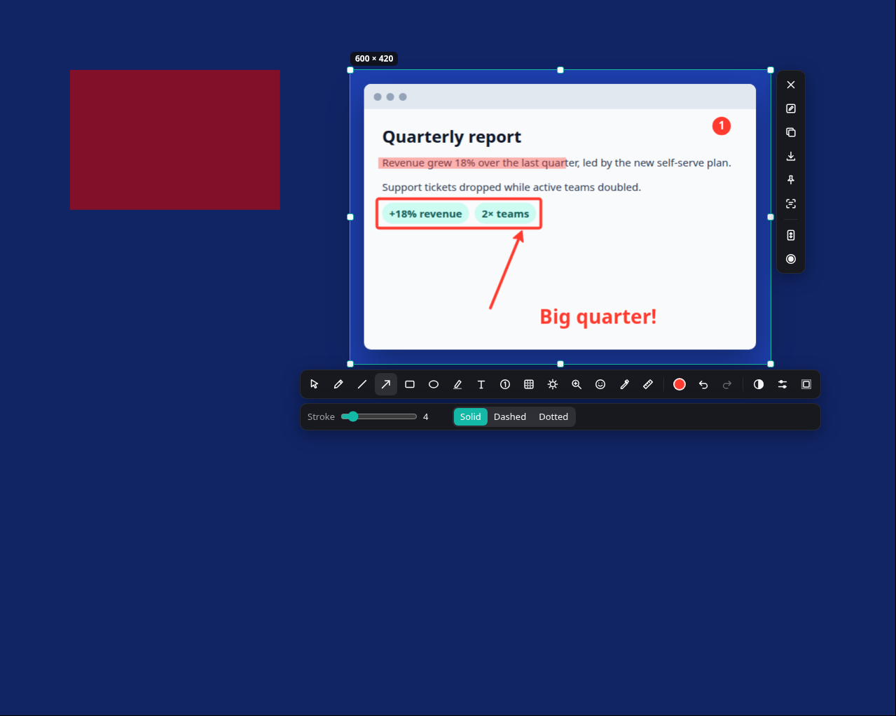
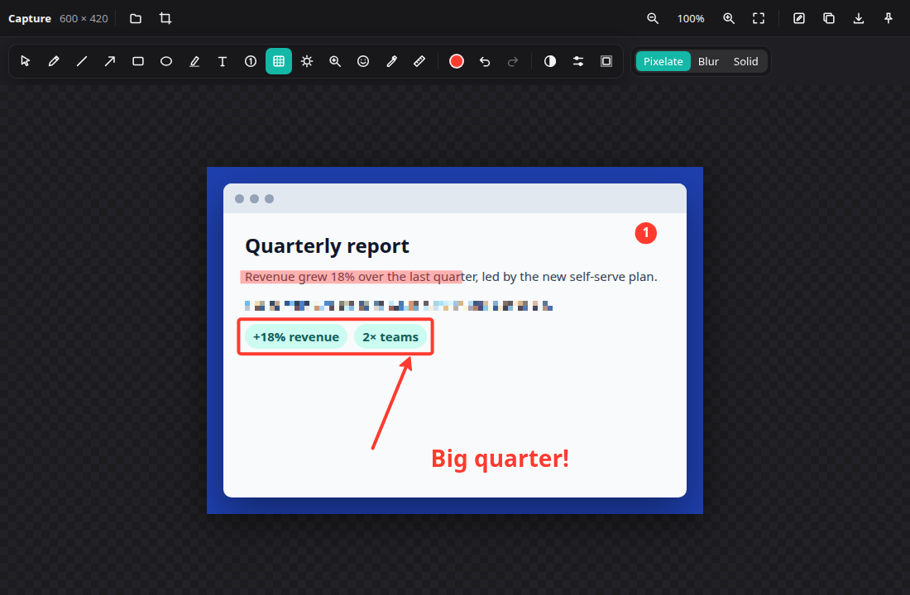

# anyshot

> **Credit:** All inspiration and feature ideas for anyshot are taken from [macshot](https://github.com/sw33tLie/macshot) by sw33tLie.
> anyshot is an independent implementation written from scratch for Windows and Linux. It contains no macshot code or assets, and is released under the MIT licence.

A lean screenshot, annotation and screen-recording app for Windows and Linux, built with Electron and TypeScript.

Status: v1 in development. Linux (X11) is tested under Xvfb; Windows builds but has not been run on real Windows yet. See [logbook.md](logbook.md) for what is done, partial and pending.





## Features

- **Lives in the tray.** At idle anyshot is the main process plus Chromium's helpers: no windows, no renderers, no timers.
- **Capture** an area, a whole screen, the last area, or text (OCR). One overlay per display at full physical resolution; drag, resize with eight handles, move with Space, Esc cancels. Capture delay of 3–30 s from the tray.
- **Annotate** with select/move, pencil, line, arrow, rectangle, ellipse, marker, text, numbered badges, censor (pixelate, blur or solid), spotlight, magnifier, measure, stamps and a colour picker. Undo/redo, duplicate, nudge, restyle selected annotations.
- **Image effects:** invert, colour adjustments with presets, and a Beautify frame (gradient background, padding, rounded corners, shadow). Censor and adjustments run as WebGL shaders.
- **Finish** with copy, save (PNG, JPEG or WebP, filename templates), pin to screen, open in the editor, OCR or upload. Enter runs your quick action.
- **After the capture:** floating preview with copy/save/pin/edit and drag-out, a history window with a quick-look preview, and pinned images you can move and zoom.
- **Editor** for captures, history entries, image files and the clipboard: zoom (hold the buttons to keep zooming), undoable crop, and editable `.anyshot` project files. Annotated captures stay editable in history; saving an edited history capture can replace it or save a copy (Ctrl+S / Ctrl+Alt+S).
- **Record** an area to MP4 (H.264, falling back to VP9/VP8 WebM) or GIF, written to disk as it records. Optional microphone. System audio on Windows.
- **Scroll capture:** select an area, scroll it, and get one stitched image.
- **OCR** offline (English) in a background process that exits when idle.
- **Uploads** to any HTTP endpoint (multipart) or S3-compatible storage (AWS, R2, MinIO, B2, Spaces). Keys are encrypted with the system keychain.
- **Settings** for every option, including global shortcuts, launch at login and an "instant capture" mode that keeps one overlay pre-loaded.

## Shortcuts

| Action | Default |
| --- | --- |
| Capture area | Alt+Shift+X |
| Capture screen | Alt+Shift+F |
| Capture text (OCR) | Alt+Shift+T |
| Record area (again to stop) | Alt+Shift+R |
| History | Alt+Shift+H |

In the overlay, after selecting: Enter quick action · Ctrl+C copy · Ctrl+S save · E editor · F pin · U upload · Ctrl+Z / Ctrl+Shift+Z undo/redo · V P L A R O M T N B H I G pick tools · Delete removes the selected annotation · Esc steps back.

Command-line actions work on a running instance too: `anyshot --capture`, `--capture-screen`, `--capture-ocr`, `--quick-capture`, `--capture-last`, `--scroll-capture`, `--record`, `--record-gif`, `--stop-recording`, `--history`, `--settings`, `--pin-clipboard`, `--open-clipboard`, `--open <file>`.

## Linux notes

- **X11** is the tested path: captures use `node-screenshots`, global shortcuts use Electron's `globalShortcut`.
- **Wayland:** captures and recordings go through the desktop's screen-sharing portal (Electron's `desktopCapturer`), which may show a permission dialog. Global shortcuts are requested through the GlobalShortcuts portal, which many desktops don't offer yet; bind `anyshot --capture` (and friends) in your desktop's keyboard settings instead. Exact overlay placement is up to the compositor. Wayland has not been tested yet.
- **Credentials** need a keyring (GNOME Keyring or KWallet). Without one, anyshot only stores upload keys if you allow obfuscated storage in Settings ▸ Uploads.
- **System audio** isn't recorded on Linux; the microphone is.

## Windows notes

Windows is a first-class target but hasn't been run on real Windows yet. To try it: install with the NSIS installer from `bun run dist` on Windows, then check captures on mixed-DPI monitors, the tray, global shortcuts, H.264 hardware encoding and loopback audio. Unsigned builds trigger SmartScreen; sign them before distributing.

## Development

Requires [bun](https://bun.sh) 1.4.

```sh
bun install
bun run build          # bundle main, preload and windows into out/
bun run start          # run the built app (windows always load the built bundles over app://)
bun run dev            # build, then run

bun run lint           # Biome lint
bun run format:check   # Biome formatting (bun run format to fix)
bun run typecheck      # tsc for main, windows and tests
bun run test           # Vitest unit tests
xvfb-run -a bun run test:e2e   # Playwright + Electron end-to-end tests (Linux)

bun run dist:dir       # unpacked build in dist/ (quick packaging check)
bun run dist           # installers: NSIS on Windows; AppImage, deb, rpm on Linux
```

The end-to-end tests launch the built app with an isolated profile, open a fixture "desktop" window with known colours and check real pixels in the clipboard and saved files. They include budget checks: no renderer process at idle, near-zero idle CPU, and renderers back to zero after windows close. `ANYSHOT_SCREENSHOTS=1 xvfb-run -a bun run test:e2e tests/e2e/screenshots.spec.ts` regenerates the screenshots above.

Architecture and performance budgets: [docs/reference/lean-electron-guide.md](docs/reference/lean-electron-guide.md). Feature list: [docs/reference/feature-reference.md](docs/reference/feature-reference.md). Decisions and deviations: [logbook.md](logbook.md).

## Licence

[MIT](LICENSE)
